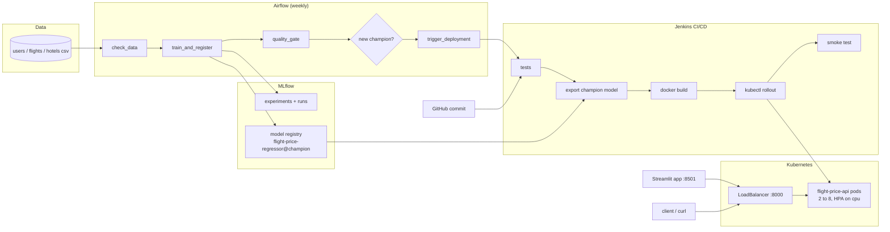

# Travel MLOps Capstone

This project uses a travel dataset (users, flights and hotels) to build three ML models and then takes the flight price model all the way to production: a Flask REST API, packaged with Docker, deployed on Kubernetes with autoscaling, retrained every week by an Airflow DAG, tracked and versioned in MLflow and shipped by a Jenkins CI/CD pipeline. A Streamlit app sits on top for the hotel recommendations and some insights from the data.

GitHub: https://github.com/Tahascommit/travel-mlops-capstone

## The three models

| Task | Data | Final model | Result (test set) |
|---|---|---|---|
| Flight price prediction (regression) | flights.csv | Random Forest on route, class, agency, distance, time | R² = 1.0, RMSE ≈ 0 (Linear Regression baseline: R² 0.919, RMSE 103) |
| Gender classification | users.csv | Logistic Regression on character n-grams of the first name | accuracy 88.3%, F1 0.879, ROC AUC 0.958 |
| Hotel recommendation | hotels.csv (+ flights for the home city) | blend of the user's own history and what people from the same home city book | hit rate@3 0.359, NDCG@3 0.249, 100% catalog coverage |

A few things worth knowing about the data, they are explained in detail in the notebooks:

- Flight price is a fixed lookup of route + class + agency (490 unique prices = 70 routes x 7 class/agency combos). That's why the random forest gets a perfect score. To get a more honest picture I also tested on routes the model never saw (GroupKFold by route), and there linear regression generalizes best (R² 0.84 vs 0.71 for the forest).
- Age, company and travel behaviour say nothing about gender (about 47% accuracy, same as guessing). The first name does. A third of the users have gender "none", they are treated as unlabeled.
- There are only 9 hotels (one per city) and most users have already stayed in 7 of them, so personal preference is weak. The recommender ranks hotels for the next trip and gives a reason for each suggestion.

## How it fits together



1. Airflow runs every week. It checks the data, trains three candidate models, logs every run to MLflow and registers the best one. The `champion` alias only moves to the new version if it is not worse than the current champion.
2. If the champion changed, Airflow starts the Jenkins job. Jenkins also runs on every new commit to `main`.
3. Jenkins runs the tests, downloads the champion model from the MLflow registry, builds the API image (tagged with the build number) and does a rolling update on Kubernetes. If the new pods don't get healthy it rolls back. A smoke test checks the live service at the end.
4. On Kubernetes the API runs behind a LoadBalancer service. The HPA keeps between 2 and 8 pods depending on CPU.
5. `/model-info` on the API shows which registry version is live, so every deployment can be traced back to an MLflow run.

## Repo structure

```
├── data/raw/                 users.csv, flights.csv, hotels.csv
├── notebooks/                the three colab notebooks (EDA + modeling)
├── src/
│   ├── config.py             paths and settings shared by everything
│   ├── data.py               loading and validation of the csv files
│   ├── flight_price/         features, training (+ mlflow) and champion export
│   ├── gender/               first name feature + training
│   └── recommender/          recommender model + training
├── models/                   saved models (.joblib) used by the api and the streamlit app
├── api/                      flask rest api
├── Dockerfile                image for the api
├── k8s/                      namespace, deployment, service, hpa + load test
├── airflow/                  airflow image and the retraining dag
├── jenkins/                  jenkins image, plugins and configuration as code
├── Jenkinsfile               the ci/cd pipeline
├── streamlit_app/            streamlit app + its dockerfile
├── docker-compose.yml        mlflow, airflow, jenkins and streamlit
├── tests/                    pytest tests for the features and the api
└── docs/                     workflow documentation and screenshots
```

Each folder has its own README with more detail.

## Running it

What you need: Docker Desktop with Kubernetes turned on (Settings > Kubernetes), and Python 3.12. I gave Docker 6 CPUs and 10 GB of memory, since Airflow, Jenkins and Kubernetes run at the same time.

### 1. Python environment and models

```bash
python3.12 -m venv .venv
source .venv/bin/activate
pip install -r requirements.txt

python -m src.flight_price.train      # also logs to mlflow, see step 4
python -m src.gender.train
python -m src.recommender.train
pytest
```

The trained models are also committed in `models/`, so this step can be skipped.

### 2. API on its own

```bash
gunicorn --bind 0.0.0.0:8000 api.app:app
# or with docker
docker build -t flight-price-api:latest .
docker run -p 8000:5000 flight-price-api:latest
```

Then open http://localhost:8000 for a small form, or:

```bash
curl -X POST localhost:8000/predict -H "Content-Type: application/json" \
  -d '{"from": "Recife (PE)", "to": "Florianopolis (SC)", "flightType": "firstClass", "agency": "FlyingDrops"}'
```

### 3. Kubernetes

```bash
docker build -t flight-price-api:latest .
kubectl apply -f k8s/namespace.yml
kubectl apply -f k8s/
kubectl -n travel-mlops get pods,svc,hpa
```

The service is on http://localhost:8000. The HPA needs metrics-server, see [k8s/README.md](k8s/README.md).

### 4. MLflow, Airflow, Jenkins and Streamlit

```bash
cp .env.example .env        # and set the passwords
docker compose up -d
```

| Service | URL | Login |
|---|---|---|
| Flask API (Kubernetes) | http://localhost:8000 | - |
| MLflow | http://localhost:5001 | - |
| Airflow | http://localhost:8080 | admin / `AIRFLOW_ADMIN_PASSWORD` from .env |
| Jenkins | http://localhost:8081 | admin / `JENKINS_ADMIN_PASSWORD` from .env |
| Streamlit | http://localhost:8501 | - |

To log training runs from your own machine to the MLflow server: `export MLFLOW_TRACKING_URI=http://localhost:5001`.

Port 5000 is not used for anything because macOS uses it for AirPlay.

## Tests

`pytest` runs the unit tests for the feature code and the API tests (valid requests, batch requests, unknown routes, bad input, 404s and the metrics endpoint). Jenkins runs the same tests on every build.

## Things that went wrong along the way

- MLflow 3 saves sklearn models with skops, which refuses tree models unless you list the tree classes as trusted. Fixed with `skops_trusted_types` in the training scripts.
- The random forest RMSE is about 1e-12, so float noise decided whether a retrained model beat the champion. The check now allows 1% tolerance.
- Jenkins build 2 failed its smoke test with an empty reply: during the rolling update an old pod was shutting down while still getting traffic. A `preStop` sleep fixed it, a rolling restart under constant load then had 0 failed requests out of 2189.
- The deployment had `replicas: 2`, so each Jenkins deploy reset the pods to 2 even when the HPA had scaled up. Removed it so the HPA owns the replica count.
- The Jenkins job is recreated by JCasC on every restart and lost its `RETRAIN` parameter until the next build, which broke the call from Airflow. The parameter is now declared in the job definition too.

## What I would add next

- Prometheus + Grafana scraping `/metrics` from all pods, with alerts on error rate and latency, and data drift checks on incoming requests.
- Retraining triggered by drift or new data instead of a fixed weekly schedule, and a shadow or canary deployment before switching traffic.
- Authentication (API keys or OAuth) and rate limiting on the API.
- A real image registry and a managed cluster (EKS / GKE) instead of Docker Desktop, with the secrets in a secret manager.
- Better recommendations once there is more signal, for example using the trip purpose or the price sensitivity of each user.
