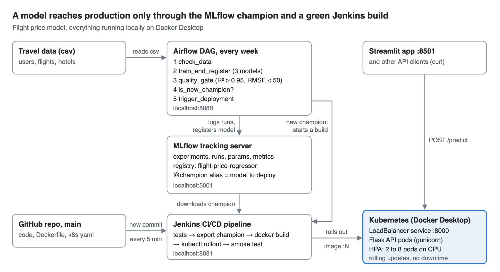

# Docs

The full write-up of the MLOps workflow (REST API, Streamlit, Docker, Kubernetes, Airflow, Jenkins, MLflow) is submitted as a separate Google Doc. These are the screenshots used in it, all taken from my local setup.

| Stage | Screenshots |
|---|---|
| REST API | [form](screenshots/01_api_form.png), [model info](screenshots/02_api_model_info.png), [curl requests](screenshots/03_api_curl.png) |
| Streamlit | [recommendations](screenshots/10_streamlit_recommendations.png), [insights](screenshots/11_streamlit_insights.png), [flight price](screenshots/12_streamlit_flight_price.png), [gender](screenshots/13_streamlit_gender.png), [models & monitoring](screenshots/14_streamlit_models.png) |
| Docker | [build, images, run](screenshots/20_docker_build.png), [docker compose ps](screenshots/21_docker_compose.png) |
| Kubernetes | [resources](screenshots/22_k8s_resources.png), [rollout history](screenshots/23_k8s_rollouts.png), [autoscaling under load](screenshots/24_k8s_hpa_scaling.png) |
| Airflow | [dag list](screenshots/30_airflow_dags.png), [dag overview](screenshots/31_airflow_dag.png), [graph of a run](screenshots/32_airflow_graph.png), [training log](screenshots/33_airflow_train_log.png), [trigger log](screenshots/34_airflow_trigger_log.png), [dag code](screenshots/35_airflow_code.png) |
| MLflow | [experiments](screenshots/40_mlflow_experiments.png), [runs](screenshots/41_mlflow_runs.png), [charts](screenshots/42_mlflow_charts.png), [registry](screenshots/43_mlflow_registry.png), [model versions](screenshots/44_mlflow_model_versions.png), [run detail](screenshots/45_mlflow_run_detail.png) |
| Jenkins | [job and stage view](screenshots/50_jenkins_job.png), [build started by airflow](screenshots/51_jenkins_pipeline_graph.png), [console start](screenshots/52_jenkins_console_top.png), [console end](screenshots/53_jenkins_console_end.png) |
